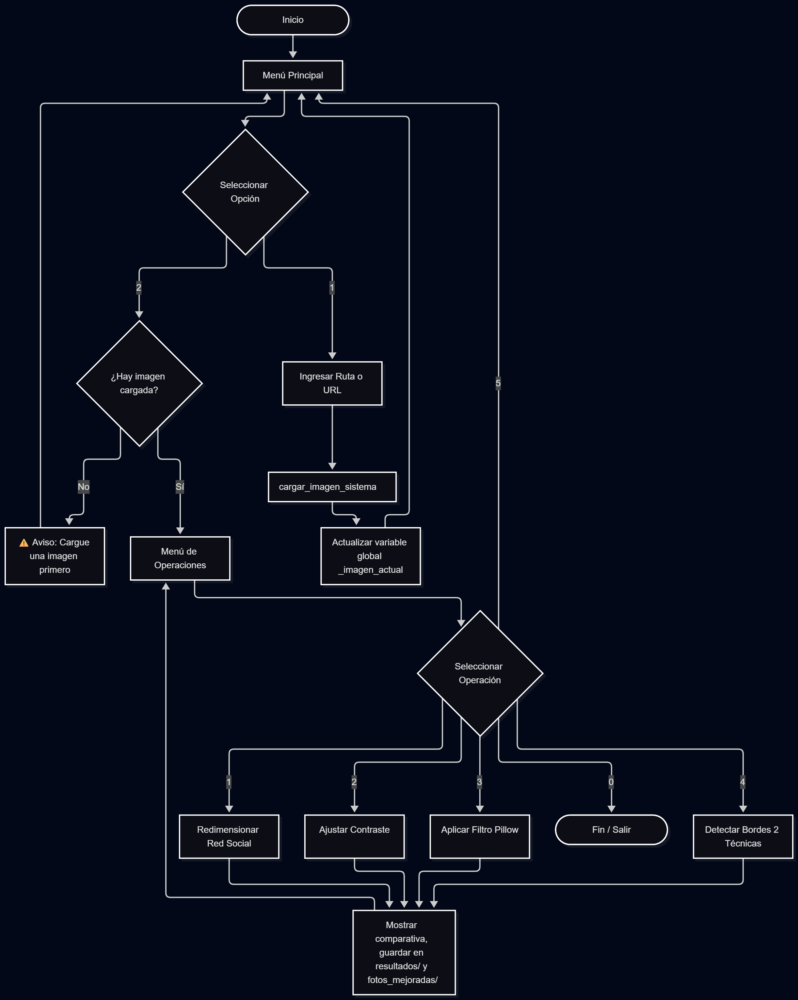

# 📸 Proyecto 2 - Parte 1: Procesamiento de Imágenes con Python
**Autores:** Moreno - Moffardin  
**Materia:** Programación Python Avanzada 2026  

Módulo de procesamiento de imágenes diseñado para preparar fotografías para redes sociales, cumpliendo con estándares de calidad, redimensionado inteligente y análisis de contraste.

---

## 📂 Estructura del Repositorio

```text
Proyecto_2_Moreno-Moffardin/
├── fotoapp.py                 # Módulo principal con funciones y menú interactivo
├── fotoapp_testdev.ipynb      # Notebook de pruebas y validación de funciones
├── fotos_originales/          # Imágenes de prueba (oscuras, claras, arquitectura, retratos)
├── fotos_mejoradas/           # Imágenes finales procesadas (limpias, listas para usar)
├── resultados/                # Figuras comparativas de Matplotlib (antes/después, histogramas)
└── README.md                  # Este archivo

---

## ⚙️ Requisitos y Dependencias

El proyecto utiliza las siguientes librerías estándar de Python:
- `Pillow` (PIL): Manipulación, redimensionado y filtros de imágenes.
- `OpenCV` (`cv2`): Detección avanzada de bordes (algoritmo Canny).
- `Matplotlib` y `NumPy`: Visualización de comparativas y generación de histogramas.
- `Requests`: Descarga y procesamiento de imágenes desde URLs en memoria.

---

## 🚀 Cómo Ejecutar el Proyecto

### Opción A: Google Colab (Recomendado)
1. Abre un nuevo notebook en [Google Colab](https://colab.research.google.com/).
2. Ejecuta la siguiente celda para clonar el repositorio e iniciar el menú:
   ```python
   !git clone https://github.com/chrismoffardin/Proyecto_2_Moreno-Moffardin.git
   %cd Proyecto_2_Moreno-Moffardin
   
   import importlib
   import fotoapp
   importlib.reload(fotoapp)
   
   # Iniciar el menú interactivo
   fotoapp.menu_principal()


---

## 🛠️ Funciones Principales

1. **`cargar_imagen_sistema()`**: Función obligatoria (Paso 1). Carga la imagen desde ruta local o URL, la optimiza y la almacena en memoria.
2. **`redimensionar_para_red()`**: Ajusta la imagen a las dimensiones de YouTube, Instagram, Twitter o Facebook. Ofrece dos modos: `contain` (mantiene la imagen completa con bordes negros) y `fit` (recorta para llenar el espacio).
3. **`ajustar_contraste()`**: Aplica ecualización de histograma (`ImageOps.equalize`) para mejorar el contraste, mostrando los histogramas antes y después.
4. **`aplicar_filtro()` / `aplicar_todos_los_filtros()`**: Permite aplicar uno o los 9 filtros clásicos de Pillow de forma comparativa.
5. **`detectar_bordes()`**: Compara dos técnicas de detección de contornos: el filtro `FIND_EDGES` de Pillow y el algoritmo `Canny` de OpenCV.

---

## 🔄 Diagrama de Flujo del Menú

El sistema implementa un menú de dos niveles que **obliga al usuario a cargar una imagen** antes de acceder a las operaciones, garantizando la integridad del flujo de trabajo y manejando excepciones de forma controlada.


